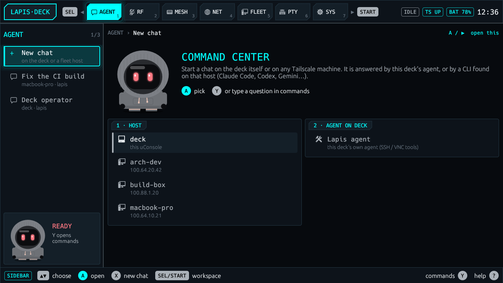
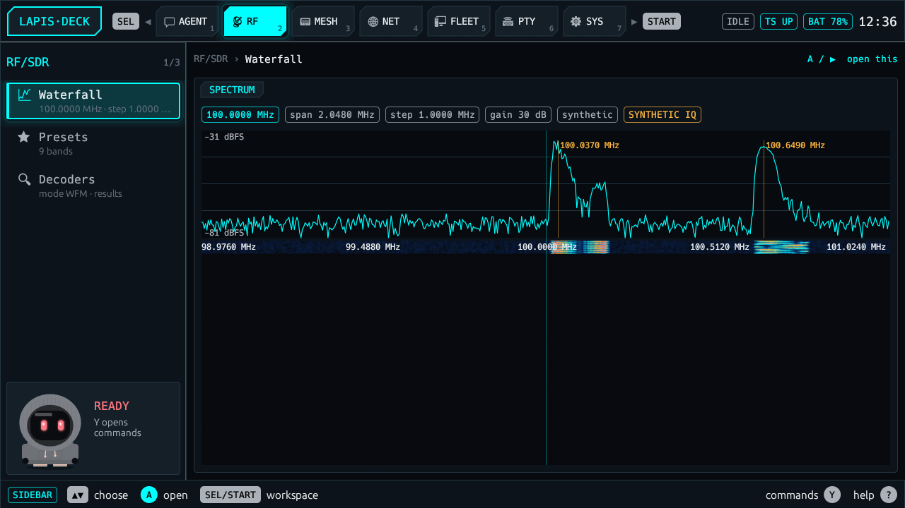
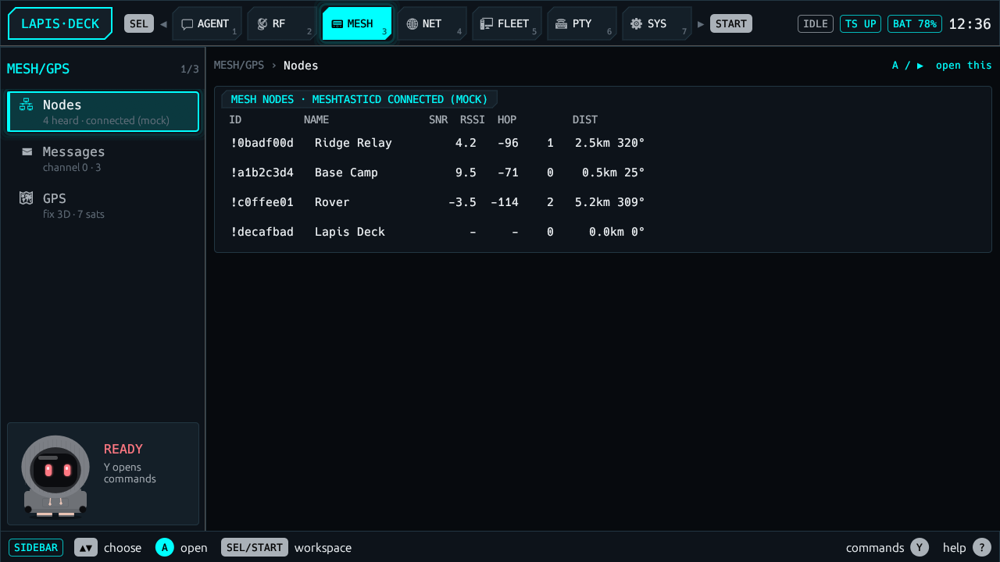
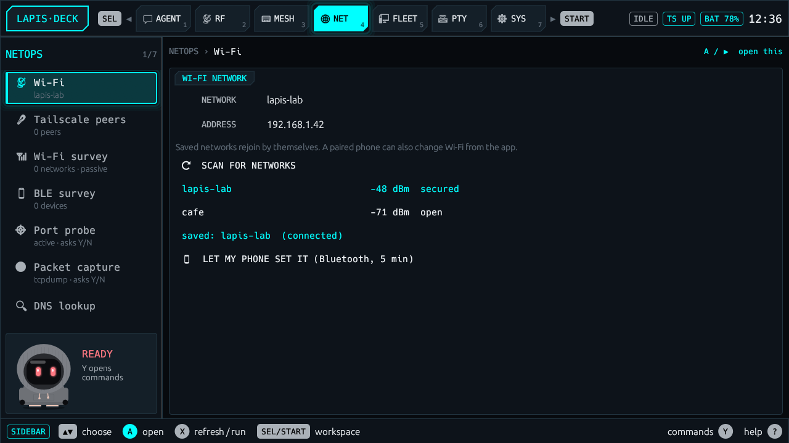
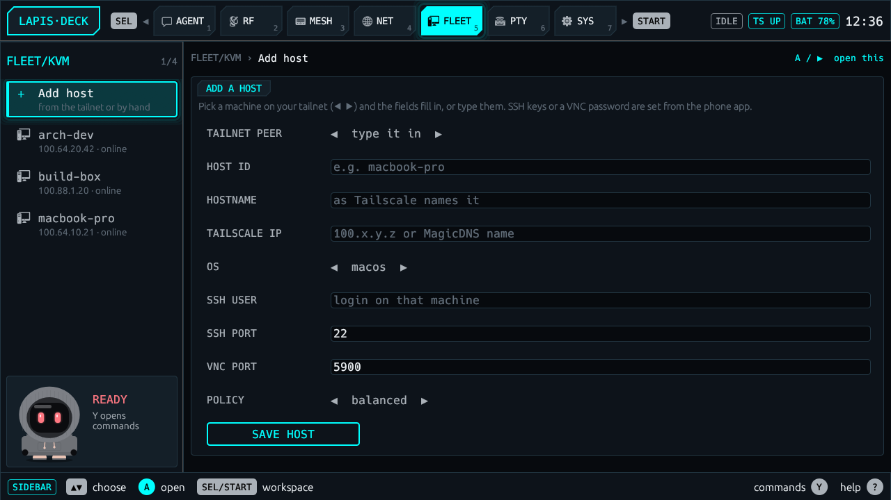

# Lapis-Deck

A standalone cyberdeck OS for the ClockworkPi uConsole (Raspberry Pi CM4): no X11, no desktop.
It boots into a keyboard- and gamepad-first HUD on DRM/KMS, runs SDR / Meshtastic / GPS / NetOps
subsystems, and hosts a policy-gated agent that operates the deck's own radios and drives the
machines on your Tailscale tailnet (VNC/SSH, or the agent CLIs installed on them). The existing
Lapis-Zero Android companion app pairs with it and controls it, unchanged.

<table>
  <tr>
    <td width="50%"></td>
    <td width="50%"></td>
  </tr>
  <tr>
    <td align="center">Command center: chats on the deck or any tailnet machine</td>
    <td align="center">RF: spectrum and waterfall</td>
  </tr>
  <tr>
    <td></td>
    <td></td>
  </tr>
  <tr>
    <td align="center">Meshtastic nodes</td>
    <td align="center">Wi-Fi: scan, join, forget, or let the phone set it</td>
  </tr>
  <tr>
    <td></td>
    <td></td>
  </tr>
  <tr>
    <td align="center">Fleet: add a machine from the tailnet</td>
    <td></td>
  </tr>
</table>

The HUD with dummy data (`scripts/preview.sh`: mock daemon and harness, synthetic IQ, a mock fleet
and mesh); on the deck it fills the uConsole's 1280x720 panel.

```
crates/lapis-crypto   lapis-ble-v1 crypto (X25519/HKDF/AES-GCM), tokens, secret redaction
crates/lapis-daemon   127.0.0.1:8421 control plane, Policy Gate, BLE provisioning, hardware, tools
crates/lapis-sdr      IQ sources (RTL-SDR, SoapySDR, synthetic), FFT/waterfall, demod, decoders
crates/lapis-ui       1280x720 HUD: DRM/KMS on the device, a window for host preview
harness/              Python agent stack (chats, fleet KVM, remote CLI harnesses, MCP tools)
companion-android/    the Lapis companion app (Lapis-Zero app + Deck features, same app id)
os-image/             pi-gen image builder, systemd units, flashing, hardware checklist
tests/vectors/        cross-language BLE crypto and redaction vectors
```

- Host preview: `scripts/preview.sh` (mock daemon + mock harness + the HUD window).
- All gates: `scripts/verify.sh`; Linux-only code (BlueZ, KMS) in an arm64 trixie container:
  `LAPIS_LINUX_FEATURES=lapis-daemon/bluez,lapis-ui/kms scripts/linux-check.sh check`.
- Image: `os-image/build.sh`, then `os-image/flash.sh /dev/diskN` (see `os-image/README.md`).

Specs: `SPEC.md`, `AGENTS.md`. Status and verification log: `PROGRESS.md`. Apache-2.0.
